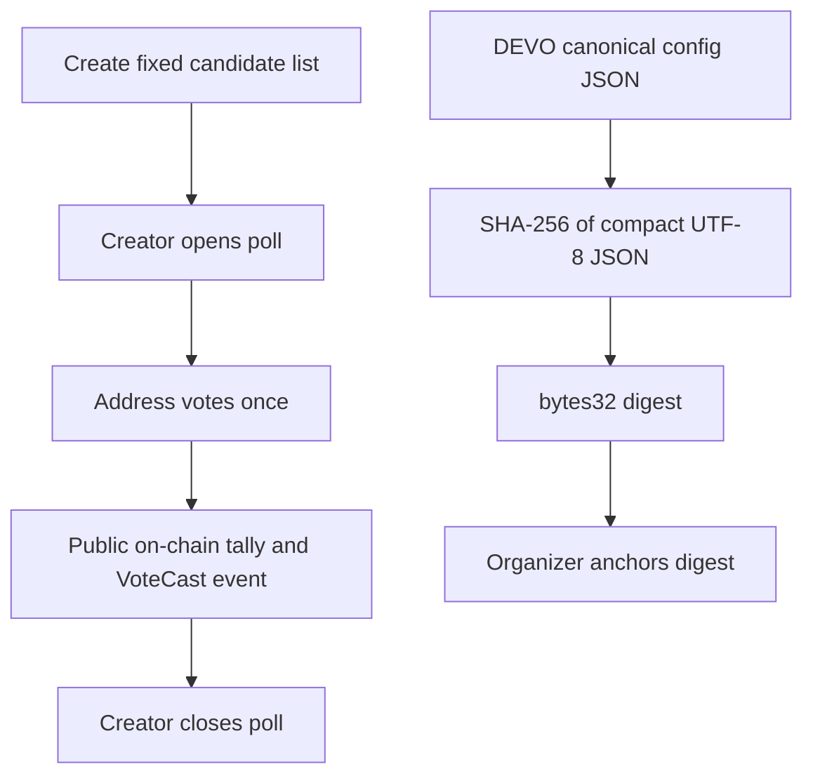

# Solidity Voting Examples

[](https://github.com/Sangram-Dhembare/solidity-projects/actions/workflows/ci.yml)

Educational Solidity contracts for fixed-candidate voting and permissionless
poll creation, tested with Foundry. `ElectionAnchor` records a supplied SHA-256
election-configuration digest; it does not run an election or verify the
configuration itself.

## Contracts

| Contract | Purpose | Key functions |
| --- | --- | --- |
| `SimpleVoting` | One fixed candidate list; one vote per address | `vote`, `candidateCount`, `candidates`, `hasVoted` |
| `PollManager` | Create polls, allow the creator to open/close voting, one vote per address per poll | `createPoll`, `openVoting`, `closeVoting`, `vote`, `getPoll`, `getCandidate` |
| `ElectionAnchor` | Record the first claim for a configuration digest | `anchor`, `verify`, `organizerOf`, `anchoredAt` |
| `ContactBook` | Maintain a caller-specific list of wallet addresses | `addContact`, `removeContact`, `isContact`, `contactCount`, `contactAt` |

Candidate lists have 2–100 entries and names are limited to 100 bytes.
Candidate indexes start at zero. `PollManager` polls start closed; creators
may reopen them, but an address can still vote only once per poll.

## Voting flow



`ElectionAnchor` accepts the 32-byte SHA-256 digest produced by DEVO's
`ElectionConfig.configHash`. The caller supplies the digest; the contract does
not parse or hash configuration JSON, validate organizer identity, or prove
that a configuration is truthful. Anyone can make the first claim for a
digest.

## Install, build, and test

Install Foundry using the [official instructions](https://getfoundry.sh/introduction/installation/),
then from this repository:

```sh
forge install
forge build
forge test
```

This repository pins `solc` 0.8.24 and `forge-std` in `foundry.toml` and
`.gitmodules`. The current suite has **41 passing tests** (including fuzz and
invariant tests), **100% line and branch coverage for all four contracts under
`src/`**, and 128,000 invariant handler calls. The deployment script is not
included in the contract coverage figure.

Useful targets:

```sh
make build
make test
make coverage
make fmt
make addresses CHAIN_ID=31337
```

## Local deployment

In one terminal start the local-only Anvil node:

```sh
make anvil
```

In another terminal deploy all four contracts using Anvil's public, local-only
unlocked account, then print their addresses:

```sh
make deploy-local
make addresses CHAIN_ID=31337
```

The default Anvil sender in the Makefile is a publicly documented development
address and must never be funded or reused on a public network.

## Testnet deployment

Testnet deployment defaults to Sepolia. Add your RPC provider URL and Etherscan
API key to an ignored local `.env` file; do not commit it. Etherscan API v2
requires an API key for verification. Foundry's `--verify` option submits source
verification after broadcasting.

Import the deployer's key into the encrypted Foundry keystore using the
interactive prompt; never put a private key in chat or a project file:

```sh
cast wallet import devo-sepolia --interactive
```

Set `SEPOLIA_RPC_URL` and `ETHERSCAN_API_KEY` in `.env`, fund the keystore
address with Sepolia faucet ETH, then deploy and print the resulting records:

```sh
make deploy-sepolia ACCOUNT=devo-sepolia
make addresses CHAIN_ID=11155111
```

For Base Sepolia, set `BASE_SEPOLIA_RPC_URL` in `.env` and run:

```sh
forge script script/Deploy.s.sol --rpc-url base_sepolia --chain 84532 --broadcast --account devo-sepolia --verify
make addresses CHAIN_ID=84532
```

If automatic verification needs to be retried, use the address and constructor
arguments from the broadcast record:

```sh
forge verify-contract --chain sepolia <SIMPLE_VOTING_ADDRESS> src/SimpleVoting.sol:SimpleVoting --constructor-args "$(cast abi-encode 'constructor(string[])' '["Alice","Bob"]')" --watch
forge verify-contract --chain sepolia <POLL_MANAGER_ADDRESS> src/PollManager.sol:PollManager --watch
forge verify-contract --chain sepolia <ELECTION_ANCHOR_ADDRESS> src/ElectionAnchor.sol:ElectionAnchor --watch
```

For Base Sepolia, replace `--chain sepolia` with `--chain 84532`. Verification
uses `ETHERSCAN_API_KEY` from `.env` and the chain's entry in `foundry.toml`.

## Deployments

**Not yet deployed.** No testnet or production addresses are published here.
Only add addresses after a real deployment and independent explorer check.

## Security notes

- Educational examples only; unaudited and not suitable for real elections.
- Vote choices, wallet addresses, events, and tallies are public on-chain.
- One vote per address is not voter eligibility: users can create additional
  addresses. There is no privacy, anonymity, coercion resistance, or Sybil
  resistance.
- Poll creators control opening and closing and may reopen a poll. There are no
  voting time windows, snapshots, or independent governance controls.
- `ElectionAnchor` records a digest claim, not the config, its provenance, or
  the caller's organizer status.
- `ContactBook` records public wallet-address associations. Do not treat its
  lists or events as private contact data.
- Candidate and name limits bound each creation loop; they do not make the
  contracts audited or safe for high-value use.

## Roadmap

- Review these contracts and document their assumptions before any real use.
- Add voter eligibility and privacy only after a concrete threat model exists.
- Keep deployments limited to testnets until independently reviewed.
